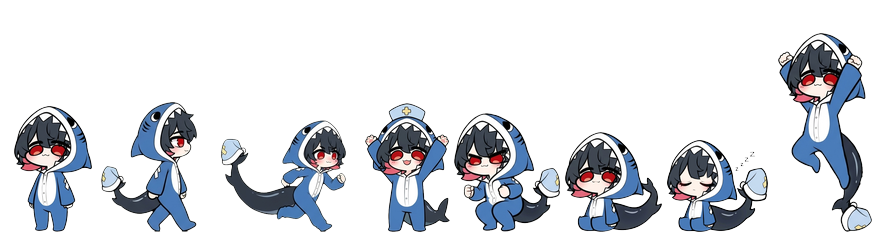

# Yorisou

**Yorisou** (寄り添う, *yorisou*) is Japanese for "to stay close to someone,
to keep them company". That is what she does: a desktop companion that sits
in a corner of your screen, keeps you company while you work, chats with you
and reacts to what you do. She runs on Linux (any Wayland compositor with
layer-shell, with extras on Hyprland and an [Omarchy](https://omarchy.org)
plugin) and on Windows.

<p align="center">
  
</p>

She can also roam across every screen on her own and pick what to do at
random (`"home": "roam"`): walk, run, chase your
cursor, dance, sit, jump, climb a screen edge, peek from the bottom, idle or
take a nap (and she naps when you leave the computer). Grab her with the
mouse and she dangles from your cursor; let go and she drops back down, or
throw her and she flies.

She also has a personality and a voice:

- **Click her to chat.** A small chat panel opens next to her and her replies
  stream into a speech bubble. By default she answers from her personality
  file (keyword-matched, in character, no model and no network). She can also
  talk through the `claude` CLI on your PC (your plan, no tools, an allowlist
  of apps she may open), a local Ollama model or Gemini. See [docs/chat.md](docs/chat.md).
- **She stays in her corner.** She sits, idles and naps in the bottom-right
  corner (`home` in `personality.json`, or `"roam"` to wander every screen)
  and only leaves it when you drag her or a reaction needs it.
- **She notices what you do.** Open the calculator, a browser, a chat app or
  a game and she has something to say about it (Hyprland events; per-app
  lines, rate-limited, optional notification reactions).
- **She reacts to your AI coding agent.** With the Claude Code hooks
  installed she thinks when you send a prompt, works on her laptop while
  tools run (the bubble says what: "Editando Service.qml"), waves when the
  agent needs you, bows when you accept, stumbles when a tool fails and
  celebrates with confetti when it is done. See
  [docs/agent-hooks.md](docs/agent-hooks.md).
- Now and then she says something on her own (can be turned off).

It is built with [Quickshell](https://quickshell.org) (QML) on Linux and Qt
Quick (PySide6) on Windows, and works with any character you want: swap the
sprites and you have your own.

Everything else stays click-through: only her own box takes mouse input
(and the chat panel while it is open).

Two characters are included: **Kumo** (`characters/kumo`, the default: a
full-body anime girl, 180 × 400 px, still with **placeholder art**) and the
original **chibi** (`sprites/`). Pick one with `character` in
`personality.json`. New art for Kumo can be made with the
[Gemini prompts](docs/gemini-sprite-prompts.md).

## Requirements

- A **Wayland** compositor with the layer-shell protocol: Hyprland, Sway,
  KDE Plasma, niri, river, Wayfire... GNOME is **not** supported (no
  layer-shell).
- [Quickshell](https://quickshell.org/docs/master/guide/install-setup).
- Python 3 (standard library only) for the chat and the agent bridge.
- Optional: Docker, only if you want a real chat model (`ollama/setup.sh`).
- Chasing the cursor, napping when you are idle and jumping to the agent's
  window only work on **Hyprland** (they use `hyprctl`). On other compositors
  she does everything else.

## Install

### Omarchy

```sh
omarchy plugin add https://github.com/DanielPuertaBernal/yorisou.git --enable
```

Optional: a `yorisou` command to turn her on and off from the terminal:

```sh
ln -s ~/.config/omarchy/plugins/danso.yorisou/bin/yorisou ~/.local/bin/yorisou

yorisou          # toggle
yorisou on       # turn on
yorisou off      # turn off
yorisou status   # prints on / off
yorisou sleep    # nap until woken
yorisou wake     # wake up
```

### Any distro (standalone)

1. Install Quickshell:

   | Distro         | Command                                                                 |
   |----------------|-------------------------------------------------------------------------|
   | Arch and derivatives | `sudo pacman -S quickshell`                                       |
   | Fedora         | `sudo dnf copr enable errornointernet/quickshell && sudo dnf install quickshell` |
   | Debian testing / unstable | `sudo apt install quickshell`                                 |
   | Others         | see the [Quickshell install guide](https://quickshell.org/docs/master/guide/install-setup) |

2. Get Yorisou and run her:

   ```sh
   git clone https://github.com/DanielPuertaBernal/yorisou.git ~/.local/share/yorisou
   quickshell -p ~/.local/share/yorisou
   ```

3. Start her with your session:

   - Hyprland (`~/.config/hypr/hyprland.conf`):
     `exec-once = quickshell -p ~/.local/share/yorisou`
   - Sway (`~/.config/sway/config`):
     `exec quickshell -p ~/.local/share/yorisou`
   - KDE Plasma and others: add the same command in your autostart settings.

To stop her: `pkill -f share/yorisou`.

### Windows

The `windows/` folder runs the same behaviour on Windows with Qt Quick
(PySide6): a small frameless, always-on-top window follows her around and
only takes the mouse while the pointer is over her. A tray icon puts her to
sleep, wakes her up or quits.

Build a standalone `yorisou.exe` (needs [Python](https://www.python.org/downloads/windows/) 3.10+):

```powershell
cd windows
.\build.ps1
.\dist\yorisou.exe
```

Or run it without building: `pip install PySide6`, then `python chibi.py`.

To start her with Windows, put a shortcut to `yorisou.exe` in the Startup
folder (`Win + R`, then `shell:startup`).

### One companion across two PCs (Deskflow)

If you share one mouse between a Linux and a Windows PC with
[Deskflow](https://github.com/deskflow/deskflow), both copies can share
her over the local network: now and then she walks off the shared
edge and appears on the other PC, and you can carry her across.

- **Carry her:** right-click her (no drag) and she hangs from the cursor; move
  to the other PC as usual and click again to drop her. (A left click opens
  the chat.) The Windows copy has no chat or agent reactions yet. Press-and-drag still
  works, but only within one PC: Deskflow does not switch screens while a
  mouse button is held.
- Only one copy shows her at a time. If the other PC goes away, she comes
  back on her own.

Configure each side with the other PC's address and where it sits, matching
your Deskflow layout. The Linux side is the `primary` (it keeps her if both
start at once).

Linux, `~/.config/yorisou/link.json` (the Windows PC is on the left):

```json
{ "peer": "192.168.1.20", "port": 47800, "side": "left", "primary": true }
```

Windows, `link.json` next to `yorisou.exe` (see `windows/link.example.json`):

```json
{ "peer": "192.168.1.10", "port": 47800, "side": "right", "primary": false }
```

Allow UDP port 47800 between the two PCs: on Linux with ufw,
`sudo ufw allow from <windows-ip> to any port 47800 proto udp`; on Windows,
accept the firewall prompt the first time `yorisou.exe` starts (private
networks).

## Your settings

Your own files live in `~/.config/yorisou/` (`personality.json`,
`chat.json`, `link.json`, `characters/`). If you used this project under its
former name, `~/.config/danso-chibi/` is copied there the first time she
starts; the old folder is left untouched.

## Talk to her

Click her, type, Enter. Esc closes the chat. She answers with lines from
her personality (`replies` matched by keyword, `fallbackReplies` otherwise):
no model, no network. Her name, tone, lines and corner live in
`config/personality.json`; copy it to `~/.config/yorisou/personality.json`
to make her yours.

Optional real model: `"backend": "claude-cli"` in `~/.config/yorisou/chat.json`
uses the `claude` CLI you are signed in to (your plan's quota; no tools, no
MCP, only the apps you allowlist in `actions`). Or `ollama/setup.sh` (Ollama
in Docker, 127.0.0.1 only) with `"backend": "ollama"`, or Gemini.
Details and the model comparison: [docs/chat.md](docs/chat.md).

## Agent reactions

Merge [`hooks/claude-code-settings.json`](hooks/claude-code-settings.json) into
`~/.claude/settings.json`. Click her while she waves to jump to the agent's
terminal. See [docs/agent-hooks.md](docs/agent-hooks.md).

## Tweak her

Edit the `Tweakables` block at the top of `Service.qml`:

| Property     | What it does                                         |
|--------------|------------------------------------------------------|
| `sleepAfterIdleSec` | Nap after the cursor has not moved this long (Hyprland) |
| `walkSpeed`, `runSpeed`, `chaseSpeed` | Speeds in px per second     |
| `margin`, `topMargin` | Distance kept from screen edges / the bar   |
| `weights`    | Relative odds of each activity                       |

Her size is `scale` in `personality.json` (0.75, 1, 1.25...; `0` keeps the
character's own).

## Make your own character

Anyone can add a character. You only need a set of sprite strips; the code
stays the same. The full animation set, sizes and fallbacks are in
[docs/sprites.md](docs/sprites.md); the steps below still work for a
character with the original eight strips.

Keep your own characters outside the repo, in
`~/.config/yorisou/characters/<name>/` (strips, `sprites.json` and an
optional `personality.json` with her own name and lines), then set
`"character": "<name>"` in `~/.config/yorisou/personality.json`.
Folders in the repo's `characters/` other than `kumo` are git-ignored.

### 1. Make the sprites

Each animation is **one PNG file with all frames side by side in a single
row** (a horizontal strip), on a transparent background:

```
walk.png   [frame 1][frame 2][frame 3][frame 4][frame 5][frame 6]
```

- All frames in a strip have the same width and height.
- The strip width is `frameWidth × frameCount`.
- `walk.png` and `run.png` must face **right**; they are mirrored automatically
  to walk left. The others can face the viewer.
- `sleep.png` can be a single frame; she "breathes" on her own.
- `hang.png` is used while held and while falling: draw her hanging by her
  hands, with the hands at the top of the frame.

The plugin uses these eight animations, so provide all of them:

| File        | Used for                         | Frames (current) |
|-------------|----------------------------------|------------------|
| `idle.png`  | standing still                   | 6                |
| `walk.png`  | walking (faces right)            | 6                |
| `run.png`   | running and chasing (faces right)| 7                |
| `dance.png` | dancing, celebrating the cursor  | 6                |
| `jump.png`  | jumping                          | 4                |
| `sit.png`   | sitting                          | 2                |
| `sleep.png` | napping                          | 1                |
| `hang.png`  | held by the mouse / falling      | 2                |

The included sprites were generated with **Google Gemini** and then cut into
strips. Any image generator or pixel-art tool works. Tips for AI generation:
ask for a "sprite sheet, single row, N frames, same character, same size,
transparent background, side view facing right" and keep the same character
description for every animation so she looks consistent.

### 2. Describe the frames

Put the strips in a folder (for example `characters/mine/`) with a
`sprites.json` describing each strip: frame size, frame count, playback speed
(`frameMs`, milliseconds per frame) and whether it is mirrored to go left
(`sideways: true` for `walk` and `run`):

```json
{
  "_meta": { "box": [90, 135], "scale": 1 },
  "walk": { "frameWidth": 109, "frameHeight": 138, "frameCount": 6, "frameMs": 140, "sideways": true }
}
```

Then set `"character": "characters/mine"` in `personality.json`. (The Windows
port still reads its own table in `windows/Chibi.qml`.)

To get `frameWidth`, divide the PNG width by the number of frames
(`file sprites/walk.png` shows the size).

### 3. Give your plugin its own id

To keep your character next to this one (or share it), copy the folder and
edit `manifest.json`:

```json
{
  "id": "yourname.companion",
  "name": "My companion",
  "author": "yourname",
  "description": "..."
}
```

The `id` must be unique; use the same name for the folder.

### 4. Try it

```sh
cp -r my-companion ~/.config/omarchy/plugins/yourname.companion
omarchy plugin validate ~/.config/omarchy/plugins/yourname.companion
omarchy plugin enable yourname.companion
```

Standalone (no Omarchy): `quickshell -p my-companion`.

Publish your folder as a git repo and others can install your character with
`omarchy plugin add <your-repo-url> --enable`. Pull requests that add new
characters or animations here are welcome too.

## Credits

- Code: Daniel Puerta Bernal.
- Sprites: the chibi was generated with Google Gemini; Kumo's current strips
  are placeholders drawn by `tools/make-placeholders.py`.

## License

MIT, see [LICENSE](LICENSE).
