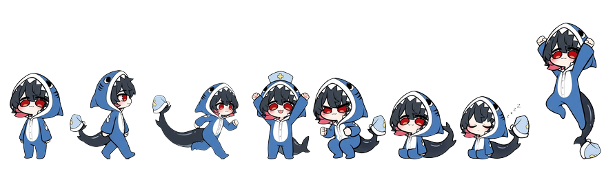

# Desktop chibi for Omarchy

<p align="center">
  
</p>

<p align="center">
  
</p>

A little chibi character that lives on your desktop. She roams across every
screen on her own and picks what to do at random: walk, run, chase your
cursor, dance, sit, jump, idle or take a nap. Grab her with the mouse and she
dangles from your cursor; let go and she drops back down.

It is an [Omarchy](https://omarchy.org) shell plugin (Quickshell / QML) and
works with any character you want: swap the sprites and you have your own.

## Install

```sh
omarchy plugin add https://github.com/DanielPuertaBernal/omarchy-desktop-chibi.git --enable
```

Requirements: Omarchy with the plugin shell, on Hyprland (cursor chasing uses
`hyprctl cursorpos`). Everything else is click-through: only her own box takes
mouse input.

## Tweak her

Edit the `Tweakables` block at the top of `Service.qml`:

| Property     | What it does                                         |
|--------------|------------------------------------------------------|
| `sizeScale`  | Size multiplier (raise it to make her bigger)        |
| `walkSpeed`, `runSpeed`, `chaseSpeed` | Speeds in px per second     |
| `margin`, `topMargin` | Distance kept from screen edges / the bar   |
| `weights`    | Relative odds of each activity                       |

## Make your own character

Anyone can add a character. You only need a set of sprite strips; the code
stays the same.

### 1. Make the sprites

Each animation is **one PNG file with all frames side by side in a single
row** (a horizontal strip), on a transparent background:

```
walk.png   [frame 1][frame 2][frame 3][frame 4][frame 5][frame 6]
```

- All frames in a strip have the same width and height.
- The strip width is `frameWidth × frameCount`.
- `walk.png` and `run.png` must face **right**; they are mirrored automatically
  to walk left. The others can face the viewer.
- `sleep.png` can be a single frame; she "breathes" on her own.
- `hang.png` is used while held and while falling: draw her hanging by her
  hands, with the hands at the top of the frame.

The plugin uses these eight animations, so provide all of them:

| File        | Used for                         | Frames (current) |
|-------------|----------------------------------|------------------|
| `idle.png`  | standing still                   | 6                |
| `walk.png`  | walking (faces right)            | 6                |
| `run.png`   | running and chasing (faces right)| 7                |
| `dance.png` | dancing, celebrating the cursor  | 6                |
| `jump.png`  | jumping                          | 4                |
| `sit.png`   | sitting                          | 2                |
| `sleep.png` | napping                          | 1                |
| `hang.png`  | held by the mouse / falling      | 2                |

The included sprites were generated with **Google Gemini** and then cut into
strips. Any image generator or pixel-art tool works. Tips for AI generation:
ask for a "sprite sheet, single row, N frames, same character, same size,
transparent background, side view facing right" and keep the same character
description for every animation so she looks consistent.

### 2. Describe the frames

Update the frame sizes in **both** places (they must match):

- `sprites/sprites.json`:
  ```json
  "walk": { "frameWidth": 109, "frameHeight": 138, "frameCount": 6 }
  ```
- the `anims` block in `Service.qml`, which also sets the playback speed
  (`frameMs`, milliseconds per frame) and whether the strip is mirrored
  (`sideways: true` for `walk` and `run`):
  ```qml
  walk: { frameWidth: 109, frameHeight: 138, frameCount: 6, frameMs: 140, sideways: true },
  ```

To get `frameWidth`, divide the PNG width by the number of frames
(`file sprites/walk.png` shows the size).

### 3. Give your plugin its own id

To keep your character next to this one (or share it), copy the folder and
edit `manifest.json`:

```json
{
  "id": "yourname.chibi",
  "name": "My desktop chibi",
  "author": "yourname",
  "description": "..."
}
```

The `id` must be unique; use the same name for the folder.

### 4. Try it

```sh
cp -r my-chibi ~/.config/omarchy/plugins/yourname.chibi
omarchy plugin validate ~/.config/omarchy/plugins/yourname.chibi
omarchy plugin enable yourname.chibi
```

Publish your folder as a git repo and others can install your character with
`omarchy plugin add <your-repo-url> --enable`. Pull requests that add new
characters or animations here are welcome too.

## Credits

- Code: Daniel Puerta Bernal.
- Sprites: generated with Google Gemini.

## License

MIT, see [LICENSE](LICENSE).
